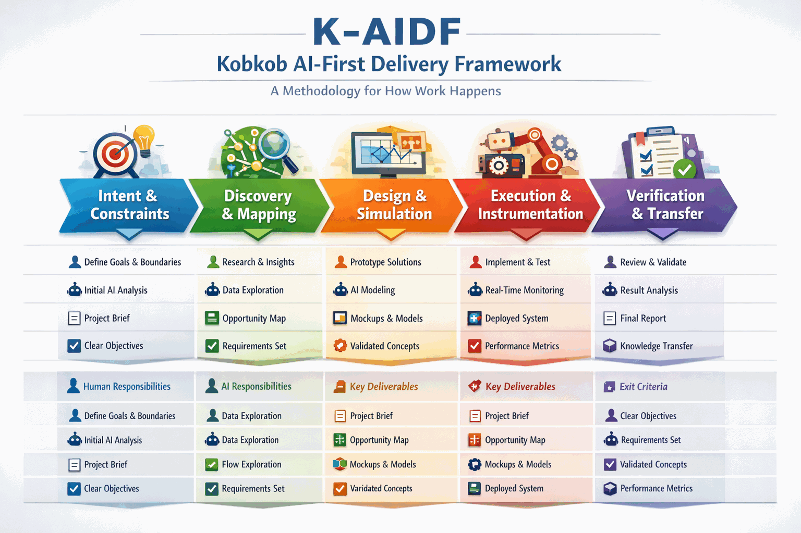

# K-AIDF

K-AIDF (Knowledge and Artificial Intelligence Development Framework) is a governance framework for the ethical, responsible, and human-centered use of AI, paired with the tooling that implements it. This repository — **kaidf core** — is the single source tree for that tooling. See `MANIFESTO.md` for the framework's founding principles.

K-AIDF uses itself as its own creation tool: the generator scaffolds a K-AIDF repository, the agent (`kob`) guides a creator through it, and the MCP server exposes it to AI clients.
### Infographic - 5 Steps



### The Terminal UI


### The Web UI


### Simplified Architecture Diagram


## Logo
```
 ▄▄▄▄▄▄▄▄▄▄▄▄▄▄▄▄
 █  ▄▄▄    ▄▄▄  █
 █  █ █    █ █  █
 █  ▀▀▀    ▀▀▀  █
 █              █
 █   █▀▀▀▀▀▀█   █
 █   ▀▀▀▀▀▀▀▀   █
 ▀▀▀▀▀▀▀▀▀▀▀▀▀▀▀▀
```

## Repository Layout

This used to be a workspace of three separate nested Git repositories. They have since been merged into this single repository (with `git subtree`, preserving history) and their standalone GitHub repos archived. All further work happens here, in one commit/PR history.

```text
K-AIDF/
├── agent-aidf/                 # the kob CLI and mentor agent
├── kobkob-kaidf-generator/      # scaffold generator (kaidf-gen)
├── mcp-aidf/                    # MCP server for AI-client integration
├── Makefile                     # root automation for all three
├── scripts/                     # shared env-loading scripts
├── deploy/                      # server deployment recipes (EasyPanel template for mcp-aidf)
├── docker-compose.local.yml     # local Ollama + MCP stack
├── MANIFESTO.md
└── README.md
```

Beyond these three components, you can add personal extensions or full projects as additional subdirectories, or fork this repo as a starting point for your own application — improvements to the core can be upstreamed back as child-project contributions.

## Components

| Component | Role | Entry point |
|---|---|---|
| `kobkob-kaidf-generator` | Generates a K-AIDF repository scaffold from a declarative YAML spec: canonical doctrine, optional maturity-model and ethical-model packs, v2 front matter | `kaidf-gen` (`validate`, `generate`) |
| `agent-aidf` | The `kob` CLI, the terminal UI, the web UI and the mentor workflow that operate on a project-local `.kaidf/`; also the KAIDF-AMM audit engine (`kob audit`) | `kob` |
| `mcp-aidf` | MCP server over HTTP: `search` and `fetch` over the generated content, and the maturity tools `get_maturity_scorecard` and `evaluate_repository_maturity`. Authenticates with a static bearer token; ships as a Docker image and an EasyPanel template | `app.py` (Flask, gunicorn in the image) |

Recommended mental model — a pipeline:

1. `kobkob-kaidf-generator` defines and generates the canonical K-AIDF file/folder structure.
2. `agent-aidf` (`kob`) consumes that structure to guide a creator's workflow.
3. `mcp-aidf` publishes selected content and search/fetch to external AI clients.

## The `kob` CLI

`kob` (`agent_aidf.cli.main`) is the entrypoint for `agent-aidf`. Run with no arguments it opens the terminal UI; with a command it runs non-interactively. `kob help <command>` shows the full help of a command.

| Command | What it does |
|---|---|
| `kob init [--force]` | Creates `.kaidf/` with the generator. `--force` replaces it and keeps the old one as `.kaidf.bak-<timestamp>` |
| `kob status` | Project and runtime status: phase, pending category, packs, apps |
| `kob mentor [answer] [--status] [--reset]` | The persisted, phase-by-phase mentor workflow |
| `kob shell` | Interactive shell with the local model |
| `kob ui` / `kob serve` | The web UI (mentor chat and the phase view) on `AIDF_UI_PORT` |
| `kob audit [path] [--json] [--severity ...] [--fail-under N] [--fail-on-critical]` | Scores a repository against the KAIDF-AMM matrix, read-only |
| `kob compile [spec] --out <dir> [--force]` / `kob gen ...` | Runs the generator's `generate` engine |
| `kob ext list`, `kob ext ...`, `kob -x <source>` | Lists and installs extensions |
| `kob appliance init --from-notebook <file.ipynb>` | Bootstraps a project from a notebook |

Global options: `--project`, `--repo`, `--model`, `--yolo` (applies mentor file writes without asking; see the agent README), `-y` for remote extension installs.

```bash
make install-generator     # bootstrap the generator venv
make install-agent         # bootstrap the agent-aidf venv (installs kob)
make install-mcp           # bootstrap the mcp-aidf venv
make test-all              # run all three test suites
```

Copy `.env.example` to `.env` and fill in `KAIDF_GENERATED_REPO` and `SECRET_KEY` (mcp-aidf). The AI controller behind `kob`'s chat, `/mentor`, and `kob shell` is local-first by default: it talks to a local Ollama/OLMo instance (see [Local Inference Stack](#local-inference-stack) below) unless you explicitly set `AIDF_CHAT_PROVIDER=openai` (in addition to `OPENAI_API_KEY`) to opt into the cloud — merely having `OPENAI_API_KEY` set in your shell is not enough by itself, so a leftover/ambient key from another project can't silently divert `kob` to the cloud. `AIDF_CHAT_PROVIDER=none` forces the no-AI stub.

Common workflow targets (all resolve/generate the default repository automatically if missing):

```bash
make generate-default              # kob gen the default spec into kobkob-kaidf-generator/out
make generate-maturity              # kob gen the maturity-model pack example
make generate-ethical                # kob gen the ethical-model pack example
make agent-status                   # kob status
make agent-mentor ANSWER="..."       # kob mentor
make agent-mentor-status             # kob mentor --status
make agent-shell                     # kob shell
make agent-ui                        # kob ui (web UI)
make agent-packs                     # legacy CLI: doctrine packs
make agent-apps                      # legacy CLI: list instant apps
make agent-app-run APP=<id> [PORT=...]  # legacy CLI: start a web instant app
make mcp-up / mcp-down / mcp-logs    # Docker Compose control for mcp-aidf
make workspace-up / workspace-down / workspace-logs  # Docker Compose control for the local OLMo/Ollama stack
make agent-tui                       # kob (interactive TUI, no subcommand)
```

Run `make help` for the full, current target list.

## Local Inference Stack

`docker-compose.local.yml` stands up a local-inference alternative to the OpenAI-backed controller: an Ollama container serving an OLMo model, plus the `mcp-aidf` server pointed at it.

```bash
make workspace-up      # detect this machine's RAM/disk/GPU, start Ollama in Docker, pull the right OLMo model
make agent-tui          # kob — free text you type is sent to the active model, results stream into the canvas
make workspace-down     # stop the local stack
```

`make workspace-up` (`scripts/workspace-up.sh` + `scripts/detect-ollama-model.sh`) picks the model tag for you instead of blindly pulling a fixed one. Ollama's library only publishes the OLMo 2 family starting at 7B (there's no smaller official OLMo to fall back to), so the tiers are: machines with >=32GB RAM or a GPU with >=12GB VRAM (and enough free disk) get the larger `olmo2:13b-1124-instruct-q4_K_M`; machines with >=8GB RAM or a >=4GB-VRAM GPU get the standard `olmo2:7b-1124-instruct-q4_K_M`; machines below that floor get a clear error instead of a pull that would be too heavy to run at a usable speed. The chosen model, plus `OLLAMA_HOST` and `KAIDF_LOCAL_INFERENCE`, are written to the workspace `.env`. Set `AIDF_OLLAMA_MODEL` to skip auto-detection and force a specific tag.

On the agent side, `agent_aidf.controller.OllamaChatController` implements the same `ChatController` interface as the OpenAI path (reusing the same repo-context builder), and `build_controller()` uses it by default — the mentor controller, `kob shell`'s `chat` command, and the `kob` TUI's free-text input all route to it automatically. Only setting `AIDF_CHAT_PROVIDER=openai` switches to `OpenAIResponsesController` (`none` forces the no-AI stub); an ambient `OPENAI_API_KEY` alone has no effect on which backend is chosen.

## Integration Contract

The authoritative integration contract lives in `kobkob-kaidf-generator/docs/contract.md` (draft v1, v2 front matter guidance). Each component owns a distinct slice:

| Concern | Owner | Downstream rule |
|---|---|---|
| Repository layout, paths, templates | `kobkob-kaidf-generator` | Specs + template library are the only source of structure |
| Document classes, stable IDs, front matter | Contract in generator docs | Generator emits; agent and MCP consume |
| Doctrine categories, pack metadata | Contract (derived layer) | Agent and MCP infer/rank; generator emits pack fields in specs |
| Mentor workflow, instant apps, contracts | `agent-aidf` | Runtime state under `.kaidf/` only — not part of the repo contract |
| MCP search/fetch, bearer-token auth, visibility policy | `mcp-aidf` | Indexes generated repos via `AIDF_REPO_ROOT`; no separate content model |

Both `agent-aidf` and `mcp-aidf` read the same indexable surface (`README.md`, `MANIFESTO.md`, `docs/**/*.md`, `docs/**/*.csv`), the same doctrine paths under `docs/00-overview/`, the same v2 front matter fields, and the same fetch-ID rule (the front matter `id`, else the path). The shared fixture in `contracts/index-contract/` checks both implementations against one expected result.

## Boundaries

- `kobkob-kaidf-generator` owns spec parsing, schema validation, template packaging, and scaffold generation.
- `agent-aidf` owns orchestration UX, prompt flows, local project interaction, and user-facing workflows.
- `mcp-aidf` owns MCP protocol handling, bearer-token authentication, indexing, search, fetch, the maturity tools, and connector-facing integration.

Avoid duplicating K-AIDF document semantics across components: the generator is the source of truth for structure, and the agent and MCP server consume generated repositories.

## Known gaps

- Indexing is implemented in both `agent-aidf/src/agent_aidf/repo.py` and `mcp-aidf/app.py`. There is no shared library; the shared contract fixture keeps the two in agreement.
- Mentor, instant-app and contract state under `.kaidf/` is runtime state, deliberately outside the generated-repository contract.
- `mcp-aidf` authenticates with a static bearer token. It is not an OAuth 2.1 authorization server.

## Next Steps

Open work is tracked as GitHub issues and milestones (`gh issue list`). The current milestone is v0.6.2.
